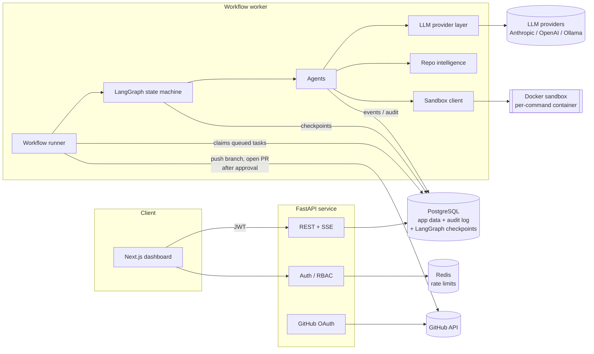
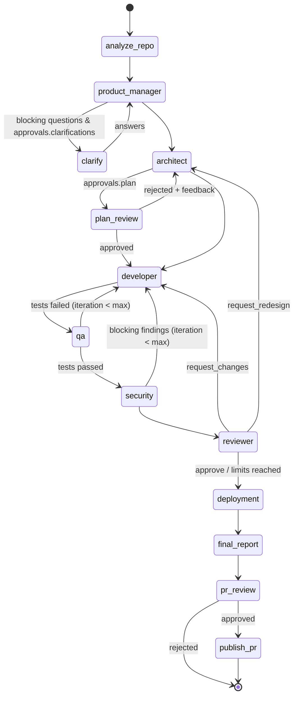

# AgentForge Architecture

AgentForge is a multi-agent software engineering platform. A user connects a repository and
describes a change. A LangGraph state machine then coordinates seven specialised agents, which
plan, implement, test, security-review, code-review and package that change as a pull request.
The PR is only opened after a human approves it.

This document explains how the system is put together and why. Two companion docs cover the rest:

- [SECURITY.md](SECURITY.md): threat model and controls.
- [ROADMAP.md](ROADMAP.md): phased plan and an honest record of what is and isn't implemented.

---

## 1. System overview



| Process | Responsibility |
|---|---|
| **API** (`app.main`) | Auth, repository connections, task CRUD, approvals, live event stream (SSE), metrics. Never runs agent code. |
| **Worker** (`app.worker`) | Claims queued tasks from the database, then runs and resumes LangGraph workflows. Talks to the sandbox and LLM providers. In development the API can embed the worker (`WORKER_MODE=embedded`). |
| **Sandbox** | Runs every command an agent wants to execute in a throwaway container: no network by default, read-only root filesystem, dropped capabilities, CPU/memory/PID limits, wall-clock timeout. |
| **PostgreSQL** | Source of truth for users, tasks, the append-only audit log (`agent_events`), LLM usage, sandbox executions, approvals, artifacts, and LangGraph checkpoints. |
| **Redis** | Shared rate-limit counters across API replicas. Optional: an in-memory limiter is used when unset. |

---

## 2. Agent workflow

The workflow is a cyclic graph. Agents can send work back upstream, and every loop has a hard
iteration cap.



### Agents

| Agent | Tools | Output (Pydantic schema) | Notes |
|---|---|---|---|
| Product Manager | read-only repo tools | `RequirementsSpec`: tasks, acceptance criteria, ambiguities, assumptions | Blocking ambiguities can pause the run for human answers. |
| Architect | read-only repo tools + repo analysis | `TechnicalDesign`: affected files, components, risks, test strategy, steps | Can be asked to redesign by the reviewer. |
| Developer | read, write, edit, sandboxed `run_command` | `ImplementationSummary`: files changed, decisions, responses to each feedback item | Must answer every open feedback item with `fixed` or `disputed` plus a rationale. |
| QA Engineer | read, write (test paths only), sandboxed `run_command` | `QAReport`: failure analysis, developer feedback, acceptance-criteria verdicts | **Pass/fail counts come from the sandbox's JUnit XML, not from the model.** |
| Security | read-only + deterministic scanners (Bandit, Semgrep when installed, secret scanner) | `SecurityReport`: findings with severity, CWE, remediation | Tool findings are kept verbatim. The model can mark them `false_positive`, but must say why. |
| Code Reviewer | read-only repo tools | `ReviewReport`: verdict + line comments | `request_redesign` sends the run back to the architect. |
| Deployment Engineer | read-only + deterministic Dockerfile/env checks | `DeploymentReport`: env vars, infra needs, instructions | **Never deploys.** No tool in its kit can touch infrastructure. |

Agents communicate through typed `AgentMessage` records in shared state (`from`, `to`, `kind`,
`content`, `refs`). The developer must respond to every message addressed to it. Disputes go back
to the sender, and the sender either withdraws the finding or keeps it with a justification. Each
message is also written to the audit log, and that log feeds the "agent communication" panel in the UI.

### Execution limits

| Limit | Default | Enforced in |
|---|---|---|
| Developer iterations (QA/security/review loops) | 4 | routing functions |
| Architecture revisions | 2 | routing functions |
| Graph steps | 80 | LangGraph `recursion_limit` |
| Tool calls per agent turn | 40 | agent tool loop |
| Cost per task (USD) | 5.00 | LLM tracking layer, raises `BudgetExceeded` |
| Wall clock per task | 60 min | worker |
| Sandbox command timeout | 300 s | sandbox backend |

When a loop limit is hit, the workflow doesn't fail silently. It continues to the report and PR
gate, and the report states explicitly that unresolved test failures, findings or review comments
remain.

### Checkpointing, retries and recovery

- **Checkpoints.** The graph is compiled with a LangGraph checkpointer (`AsyncPostgresSaver` in
  production, `AsyncSqliteSaver` in development), and the task id is the thread id. Every
  super-step is persisted.
- **Retries.** LLM calls retry transient errors (rate limits, 5xx, timeouts) with exponential
  backoff and jitter. Nodes have a LangGraph `RetryPolicy` for transient infrastructure errors.
- **Recovery.** If a node still fails after retries, the task is marked `failed`, but its
  checkpoint survives. `POST /api/tasks/{id}/resume` re-runs the graph from the last successful
  super-step.
- **Human-in-the-loop.** Gate nodes call LangGraph `interrupt()`. The worker records an `Approval`
  row and sets the task to `awaiting_approval`. When a human decides through the API, the task is
  re-queued, and the worker resumes the graph with `Command(resume=decision)`.

---

## 3. Key technical decisions

| # | Decision | Why | Trade-off |
|---|---|---|---|
| D1 | **LangGraph** for orchestration | First-class cycles, conditional edges, `interrupt()`, durable checkpoints. These are exactly the primitives an agent team with revision loops needs. | Tied to LangGraph's state model. Kept thin: agents are plain classes, so the graph only wires them together. |
| D2 | **Postgres as the job queue** (claim with an atomic `UPDATE … WHERE status='queued'`) rather than Celery/RQ | One fewer moving part. Tasks are long-running and low-volume, and the queue lives transactionally next to the task row. | Not built for thousands of jobs per second (not a requirement here). |
| D3 | **Audit log in the database, SSE tails it** | One durable, ordered event stream (`agent_events.seq`) is both the audit trail and the live feed. Replicas stay stateless, and clients can resume from any `seq`. | ~500 ms polling latency per open stream. Redis pub/sub can be layered on later. |
| D4 | **Provider abstraction with a normalised message/tool format** | Model choice per agent (e.g. a cheap model for PM, a strong one for Developer). Local models via any OpenAI-compatible server (Ollama, vLLM). | Provider-specific features (Anthropic thinking blocks, prompt caching) are passed through opaquely rather than modelled. |
| D5 | **Structured outputs everywhere** (JSON Schema derived from Pydantic, validated on return) | Routing decisions are made on typed fields, never on free text. | Small local models sometimes violate schemas. We retry with the validation error, then fail loudly. |
| D6 | **Ground truth comes from tools, not models** | Test pass/fail comes from parsed JUnit XML, the diff comes from `git diff`, and scanner findings from scanner JSON. Models analyse these; they can't override them. | None. This is a hard requirement. |
| D7 | **Fresh clone per task** in `WORKSPACES_ROOT/<task_id>/repo` | Tasks never share mutable state, and a failed task can be inspected after the fact. | Disk use. A retention job is on the roadmap. |
| D8 | **Docker sandbox per command** (not a long-lived container) | No state leaks between commands, easy to enforce timeouts, and the security boundary stays simple. | Container start-up cost (~300 ms) per command. |
| D9 | **macOS Seatbelt backend for local development only** | Lets you develop and test the full loop on a Mac without Docker. It is still kernel-enforced: no network, no writes outside the workspace, no reads of `$HOME`. | Weaker than a container. Refuses to start when `ENVIRONMENT=production`. |
| D10 | **Refresh-token rotation with reuse detection** | Short-lived (15 min) access JWTs. Refresh tokens are opaque, hashed at rest, and rotated on every use. Reusing a rotated token revokes the whole token family. | Needs a DB lookup on refresh (not on normal requests). |
| D11 | **GitHub tokens encrypted at rest** (Fernet) and passed to git via environment config | Tokens never land in `.git/config`, process arguments or logs. | Key rotation is manual for now. |
| D12 | **Lexical + AST retrieval first, embeddings optional** | Code search is mostly symbol- and identifier-driven. AST indexes and BM25 are deterministic and cheap. Embeddings (`EMBEDDINGS_PROVIDER`) re-rank results when configured. | Pure semantic queries are weaker without embeddings. |

---

## 4. Repository structure

```
.
├── backend/
│   ├── app/
│   │   ├── main.py                # FastAPI app factory, lifespan, middleware
│   │   ├── worker.py              # standalone worker entry point
│   │   ├── core/                  # config, security (JWT/hashing/crypto), logging, telemetry, errors
│   │   ├── db/                    # SQLAlchemy models, session, base
│   │   ├── schemas/               # Pydantic API contracts
│   │   ├── api/                   # routers + dependencies (auth, RBAC)
│   │   ├── services/              # auth, repositories, tasks, events, metrics
│   │   ├── llm/                   # provider abstraction, Anthropic + OpenAI-compatible providers, pricing, tracking
│   │   ├── agents/                # seven agents, tool kit, tool loop, prompts/
│   │   ├── orchestration/         # LangGraph state, graph, routing, checkpointer, runner
│   │   ├── intelligence/          # scanner, languages, dependencies, Python AST, JS imports, graph, search
│   │   ├── sandbox/               # command policy, Docker + Seatbelt backends
│   │   ├── security_tools/        # Bandit / Semgrep / secret scanning wrappers, local rules
│   │   └── vcs/                   # git operations, GitHub REST client
│   ├── migrations/                # Alembic
│   └── tests/                     # unit + integration (fakes live only here)
├── frontend/                      # Next.js 15 + TypeScript + Tailwind dashboard
├── sandbox/Dockerfile             # sandbox image (Python, Node, Bandit, Semgrep, pip-audit)
├── examples/demo-service/         # small FastAPI service used for the auth-module demo
├── docker-compose.yml
├── .github/workflows/ci.yml
└── docs/
```

---

## 5. Data model

| Table | Purpose |
|---|---|
| `users` | Email, argon2id password hash, role (`admin` / `engineer` / `viewer`). |
| `refresh_tokens` | SHA-256 hashed opaque tokens with `family_id`, `replaced_by_id`, `revoked_at`, for rotation and reuse detection. |
| `github_connections` | GitHub login + Fernet-encrypted OAuth token per user. |
| `repositories` | Source (`github` / `git_url` / `local`), default branch, cached analysis JSON. |
| `tasks` | Request, config (models, limits, approval preferences), status, current node, cost/token totals, branch, PR URL, error. Also the queue (`status='queued'`, `pending_resume`). |
| `agent_events` | **Append-only audit log.** `(task_id, seq)` unique. Node start/finish, LLM calls, tool calls, agent messages, routing decisions, sandbox runs, approvals, errors. |
| `llm_calls` | Provider, model, tokens (incl. cache), cost, latency, status. Feeds the cost dashboard. |
| `sandbox_executions` | Command, backend, network mode, exit code, duration, timeout flag, truncated stdout/stderr. |
| `approvals` | `clarification` / `plan` / `pull_request` gates with requested payload and the human decision. |
| `task_artifacts` | Versioned outputs per iteration: requirements, design, diff, QA/security/review/deployment reports, final report. |

---

## 6. Observability

- **Logs.** structlog JSON, with `request_id`, `task_id`, `agent` and `node` bound through context vars.
- **Traces.** OpenTelemetry spans for HTTP requests (FastAPI instrumentation), workflow nodes,
  LLM calls (`gen_ai.*` attributes: system, model, token usage), tool calls and sandbox runs.
  Exported over OTLP/HTTP when `OTEL_EXPORTER_OTLP_ENDPOINT` is set.
- **Metrics.** `GET /api/metrics/summary` aggregates success rate, task throughput, tokens and
  cost per model/agent, LLM latency percentiles and sandbox outcomes from the database. The
  dashboard reads this endpoint.
- **Errors.** Every unhandled node exception is recorded as an `error` event with its type and
  message (no stack-trace secrets), and the task stores the terminal error.
